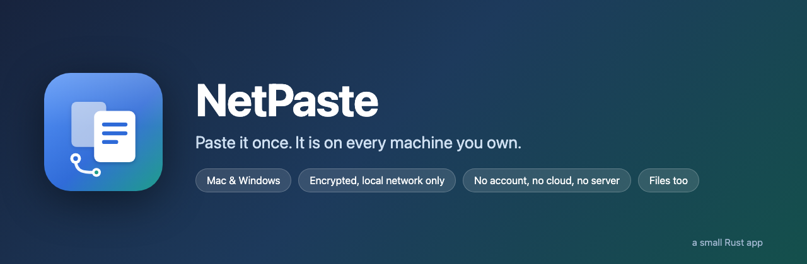
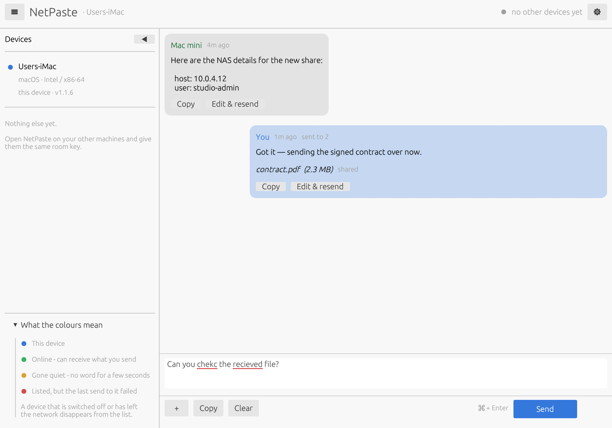
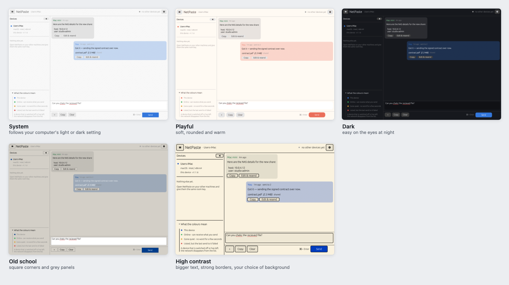

<p align="center">
  
</p>

<p align="center">
  <strong>A shared clipboard for the machines on your own desk.</strong><br>
  Paste into one window; it appears in the same window on every other machine,
  ready to copy straight out again. Files too.
</p>

<p align="center">
  
  
  
  
</p>

---

## Why you might want this

You have more than one computer on your desk. Several times a day you need to
get a short piece of text from one to another — a licence key, an SSH command,
a URL, a block of log output, a password from the manager that is only set up
on one machine. The usual options are all slightly wrong:

| What people normally do | Why it grates |
| --- | --- |
| Email or message it to yourself | A permanent copy of your NAS password now lives on someone else's server |
| A cloud clipboard or notes app | Needs an account, a subscription, and an internet connection for a 40-character string going three feet |
| A USB stick | For one line of text |
| Retyping it | Fine until it is a 64-character hash |
| AirDrop / Nearby Share | Same-ecosystem only; nothing that spans a Mac and a PC |

NetPaste is the small, boring answer: **one window, open on each machine, that
shows the same text.** The text never leaves your local network, there is no
account, and there is no server anywhere — the apps talk directly to each
other.

**It is particularly good for:**

- **A mixed desk.** An Intel iMac, an Apple-silicon Mac and a Windows 10 PC all
  see the same box. Nothing else here does Mac *and* PC without a cloud account.
- **Credentials and keys in passing.** Long random strings that must not be
  mistyped and should not be emailed.
- **Handing a file across without ceremony.** A PDF, a photo, a log. The
  recipient chooses where to save it, or ignores it.
- **Borrowing one machine's input from another.** Dictation is the clearest
  case: your phone or your Mac has a microphone and a dictation engine that
  works well, and the machine you are actually working on does not — no mic, a
  bad one, a locked-down build, or an OS whose dictation you do not get on
  with. Speak into the good machine, send, and carry on typing-free on the
  other one. The same goes for any input that lives on the wrong device: a
  scanner's OCR output, a password manager that is only set up in one place, a
  barcode app, handwriting recognition on a tablet.
- **Machines with no internet.** An air-gapped or isolated LAN works exactly the
  same, because the internet was never involved.
- **People who find most interfaces too small or too low-contrast.** There is a
  high-contrast skin with larger text and a background colour you choose.

**It is deliberately not:** a sync service, a chat app, an archive, or anything
that works beyond your own network. The history lives in memory and is gone when
you close the app. That is the point.

---

## What it looks like



- **Left** — the devices running the app right now, with a key explaining the
  coloured dots. The list slides away with the ◀ button.
- **Middle** — what has been shared. Every message has **Copy**, which puts it
  on *this* machine's clipboard, and **Edit & resend**.
- **Bottom** — the box you paste into, with **+** for files, and **Send**
  underneath where you would expect it.

### Five skins



Pick one in ⚙ Settings. **High contrast** is the one that matters most: larger
text, a strong border on every control, secondary text kept at near-full
strength rather than greyed out, and a background colour you choose — black,
cream, navy, yellow, or anything from the colour picker. Text and borders flip
between black and white automatically, whichever stays readable on the colour
you set.

---

## Install

### macOS — Intel and Apple silicon

```bash
git clone https://github.com/chattydogmagazine/netpaste.git
cd netpaste
rustup target add x86_64-apple-darwin aarch64-apple-darwin   # once, for a universal build
./package-macos.sh
```

That produces **NetPaste.app**. Drag it to Applications and open it. The script
builds for both kinds of Mac and merges them into one bundle, so the same app
runs natively on an old Intel iMac and an M-series machine — and so they can
update each other later.

> **NetPaste is not code-signed or notarised**, so if you ever get a copy you
> did not build yourself, macOS will refuse it with *"NetPaste cannot be opened
> because the developer cannot be verified."* Right-click the app → **Open** →
> **Open**, or clear the quarantine flag with
> `xattr -dr com.apple.quarantine /Applications/NetPaste.app`. An app you built
> on your own machine is not quarantined and opens normally.
>
> Signing would need a paid Apple Developer account, and this is a small
> noncommercial tool. Building it yourself from source — which takes one
> command — is both the recommended route and the one where you can see exactly
> what you are running.

> macOS will ask **"NetPaste would like to find and connect to devices on your
> local network."** You must allow it, or the device list stays empty while
> everything else looks like it is working. If you miss the prompt, tick
> NetPaste under *System Settings → Privacy & Security → Local Network*.

### Windows 10 / 11

```bash
git clone https://github.com/chattydogmagazine/netpaste.git
cd netpaste
cargo build --release
```

The app is `target\release\NetPaste.exe` — one file, no installer, no console
window behind it. Copy it wherever you like; a sensible home is
`%LOCALAPPDATA%\Programs\NetPaste\`.

> **The .exe is not code-signed**, so a copy you did not build yourself will
> trip Microsoft Defender SmartScreen: *"Windows protected your PC."* Click
> **More info → Run anyway**. A code-signing certificate costs real money per
> year, which a noncommercial tool does not justify — so building from source
> is the recommended route, and you can read every line of what you run.

<details>
<summary><strong>Building on Windows without Visual Studio</strong> (click)</summary>

Rust's default Windows toolchain is MSVC, which needs the multi-gigabyte Visual
Studio Build Tools. The GNU toolchain avoids that, but needs a *complete*
MinGW-w64 on PATH: the one bundled with Rust ships `dlltool.exe` without the
assembler it calls, so builds fail with `dlltool: CreateProcess`.

```powershell
rustup-init.exe -y --default-host x86_64-pc-windows-gnu --profile minimal
```

Then unpack a MinGW-w64 build such as [WinLibs](https://winlibs.com) and put
its `bin` directory first on PATH:

```powershell
$env:PATH = "C:\tools\mingw64\bin;$env:USERPROFILE\.cargo\bin;$env:PATH"
cargo build --release
```
</details>

> Windows will ask to allow NetPaste through the firewall — allow it. If the
> prompt was missed, the device shows up **red** in everyone else's list: it is
> announcing itself, but nothing can reach it. From an administrator PowerShell:
>
> ```powershell
> New-NetFirewallRule -DisplayName "NetPaste (TCP in)" -Direction Inbound -Action Allow -Protocol TCP -LocalPort 45455 -Program "$env:LOCALAPPDATA\Programs\NetPaste\NetPaste.exe" -Profile Any -RemoteAddress LocalSubnet
> New-NetFirewallRule -DisplayName "NetPaste (UDP in)" -Direction Inbound -Action Allow -Protocol UDP -LocalPort 45454 -Program "$env:LOCALAPPDATA\Programs\NetPaste\NetPaste.exe" -Profile Any -RemoteAddress LocalSubnet
> ```
>
> Note `-Profile Any`. A home network that Windows has classified as **Public**
> ignores rules written for the Private profile, which is the usual reason this
> still looks broken after it was "fixed".

### Linux

`cargo build --release`. Discovery and transfer work the same; the spell
checker is a no-op because there is no single system dictionary to call.

---

## First run

NetPaste asks two things:

1. **A name for this device** — what the other machines will call it.
2. **A room key** — it suggests one like `cedar-opal-willow-412`.

Type **the same room key on every machine**. That is the entire setup. Devices
find each other within a couple of seconds.

Both are saved immediately and again when the app closes, so you type them once
per machine and never again — every later launch goes online by itself.

---

## Using it

| Want to | Do this |
| --- | --- |
| Share text | Paste or type in the box, press **Send** (or ⌘/Ctrl + Enter) |
| Get text onto this machine's clipboard | **Copy** on any message |
| Reuse something with a tweak | **Edit & resend** |
| Share files, photos, documents | **+**, pick them, **Send** |
| Save a file someone sent | **Save…** on the offer, choose where |
| Change the look | ⚙ → Appearance |
| Fix a typo | Misspellings are underlined; corrections appear under the box |

### The device list

| Dot | Meaning |
| --- | --- |
| 🔵 Blue | This device |
| 🟢 Green | Online, and able to receive what you send |
| 🟠 Amber | Gone quiet — nothing heard for a few seconds |
| 🔴 Red | Still announcing itself, but the last message sent to it did not arrive |

A machine that is switched off or has left the network **disappears** from the
list within eight seconds, so red never means "offline" — it means something is
in the way, nearly always a firewall.

### Files

Attachments are **offered, not pushed**. Other devices see the name and size
with a **Save…** button; nothing is written to anyone's disk until they click
it and choose a location. The sending app has to still be open at that moment,
because the file is pulled live from it rather than parked on a server.

### History

Nothing is written to disk — the conversation is in memory and starts empty
each launch. Caps are in ⚙ Settings: **50 / 100 / 150 messages** and
**5 / 10 / 15 attachments**. Older items fall off the top, and when a message
with attachments ages out the app stops offering those files.

### Spell check

The compose box uses the spell checker already built into the operating system
— NSSpellChecker on macOS, the Windows Spell Checking API on Windows — so it
follows the language and personal word list you already have, and nothing is
bundled with the app. Lines containing anything code-shaped (a path, URL, key,
hash or command) are skipped entirely, which is most of what gets pasted here.

### Devices on another network

NetPaste finds devices by calling out across the local network, which is why
it needs no configuration — and also why a machine on the far side of a VPN is
invisible even though it is perfectly reachable. Multicast and broadcast stop
at the edge of the local network; unicast does not.

Turn on **⚙ → Devices on other networks** and name the machine directly — a
Tailscale name, a hostname, or an IP:

```
mac-mini-vmi3457213          # a tailnet name
100.107.91.102               # or just the address
192.168.9.14:45454           # add a port only if you changed the default
```

**Only one of the two devices needs the other's address.** A device that hears
from a machine it has never seen before answers straight back to where the
packet came from, which reaches networks its own multicast never will — so the
far machine learns about you without being configured at all. Hostnames are
looked up again every 30 seconds, so a name whose address moves is followed.

It is off by default and behind a toggle on purpose: it sends this device's
name and presence to an address beyond your LAN, and that should be a decision
rather than a surprise. Switch it off and nothing leaves the local network
again.

> Each named device shows a dot in settings — green once it has answered,
> amber while the address resolves but nothing has replied yet, red if the name
> cannot be looked up at all. That is usually enough to tell a typo from a
> firewall.

---

## Updates spread by themselves

Give **one** machine a newer build and the others take it from that machine and
restart into it. There is no update server and no second round of installs.

Each device already advertises its version and a fingerprint of its own
executable. A device on an older build pulls the new one over the same
encrypted channel it uses for everything else, checks the download matches the
advertised fingerprint **and** that it can actually run on this machine, then
swaps it in and restarts. The old version is kept until the new one starts, and
cleared on the next launch. Anything that fails is rolled back, written to
`update.log` beside the settings file, and not retried.

Updates only travel between machines of the same kind — macOS devices share one
universal bundle, Windows devices share the `.exe`. A Mac never tries to update
a PC. You can turn the whole thing off in ⚙ Settings, which leaves a banner
offering the update instead.

> **Be clear-eyed about this:** anyone holding the room key can hand your
> devices a new build of this app, and they will run it. That is what the
> feature *is*. It makes the room key as powerful as the machines it unlocks —
> treat it like a password and share it only with machines you trust.

---

## How it works

```
  ┌──────────────┐        every 2s: encrypted "I am here"        ┌──────────────┐
  │  Studio iMac │ ──── UDP multicast 239.255.42.99:45454 ────▶  │   Mac mini   │
  │              │ ◀─────────── and UDP broadcast ────────────── │              │
  └──────┬───────┘                                               └──────┬───────┘
         │                                                              │
         │   Send  ──▶  one short TCP connection per device, port 45455 │
         │              carrying one XChaCha20-Poly1305 sealed frame    │
         └──────────────────────────────────────────────────────────────┘
```

- **Discovery.** Every app announces itself twice a second-and-a-half on both
  UDP multicast *and* broadcast, because different networks drop different
  ones. The announcement itself is encrypted, so an app with a different room
  key cannot read it — a device in another room never appears at all, not even
  as a name.
- **Messages.** Sending opens a short TCP connection to each known device and
  writes a single sealed frame.
- **Files.** Pulled on demand in sealed 256 KB chunks into a `.netpaste-part`
  file, renamed into place only once the byte count matches what was promised.
- **Crypto.** XChaCha20-Poly1305 with a key derived from the room key by
  SHA-256. Every frame carries its own random nonce and is authenticated, so a
  tampered or foreign frame is dropped rather than displayed.

### Ports

| Port | Use |
| --- | --- |
| UDP 45454 | finding other devices |
| TCP 45455 | messages, file transfers and updates |

If 45455 is busy the app takes the next free port up to 45470, so a second copy
on one machine still starts. Both are changeable in the settings file.

### Where things live

| | macOS | Windows |
| --- | --- | --- |
| Settings | `~/Library/Application Support/NetPaste/config.json` | `%APPDATA%\NetPaste\config.json` |
| Update log | same folder, `update.log` | same folder, `update.log` |

If you hand-edit the settings on Windows, save as UTF-8 **without** a
byte-order mark — PowerShell's `Set-Content -Encoding utf8` adds one.

---

## Honest limitations

- **Same network, or a VPN you already run.** There is no internet relay by
  design. Devices on the same LAN find each other automatically; devices
  anywhere else need naming once (see *Devices on another network*), and that
  only works if something like Tailscale already carries the traffic.
- **One shared room, not private messaging.** Everyone with the key sees
  everything, and can push a build.
- **No history.** Close the app and the conversation is gone.
- **Nothing is signed.** Neither notarised by Apple nor signed for Windows, so
  a copy you did not build yourself will be met by Gatekeeper or SmartScreen
  (see the install notes above for how to get past each). Certificates cost
  money every year; building from source is free, takes one command, and lets
  you see what you are running.
- **Networks that block both multicast and broadcast** (some guest Wi-Fi, some
  "client isolation" access points) will leave the list empty even though
  everything else is correct.

---

## Development

```bash
cargo test          # the full suite
cargo run           # a debug build
```

The tests start real nodes on real sockets and check that they discover each
other, that long unicode text and a 900 KB file survive the round trip byte for
byte, that a device with the wrong room key sees nothing at all, and that the
spell checker flags typos while leaving commands, paths and hashes alone. They
pass on macOS and on Windows.

| Path | What it is |
| --- | --- |
| `src/net.rs` | discovery, transport, file and update transfer |
| `src/crypto.rs` | key derivation and sealed frames |
| `src/proto.rs` | wire format |
| `src/theme.rs` | the five skins |
| `src/spell.rs` | the OS spell checkers |
| `src/update.rs` | packaging, verifying and swapping in a new build |
| `src/main.rs` | the window |
| `branding/` | icon sources and the script that builds every size |

Useful while hacking:

```bash
cargo run --example peers -- "<room key>"        # list devices on the network
cargo run --example send_probe -- "<room key>" "hello"   # send without the UI
```

---

## Licence

[PolyForm Noncommercial 1.0.0](LICENSE) — **personal and noncommercial use
only.**

Use it on your own machines, at home, for study, for a hobby project, inside a
charity or a school. Read it, change it, pass your changes on under the same
terms. What you may **not** do is use it commercially: selling it, putting it
inside a product or service you charge for, or running it as part of a
business's commercial operations. If you want to do that, open an issue and ask
— a separate licence can be granted.
